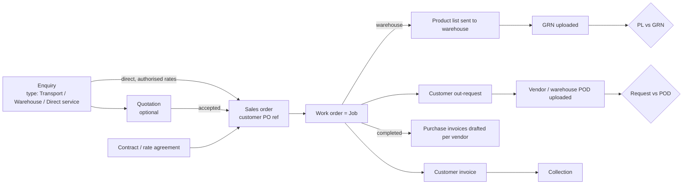

# AENIX ERP — Order-to-Cash and Fulfilment Flow (FLOW-001)

Version 0.1 | 2026-11-23 | Source: Project Owner instruction in the Claude session | Status: **PROPOSED, prototype only**. The new Sales Order entity and the GRN/POD controls extend the signed requirements baseline. DOBIS must record them as a change request before backend contracts are written.

## Owner instruction (summary)

- A work order is **not always transport**. A request, order or job can be:
  - **Transport**, where a mode (Road, Sea or Air) applies;
  - **Warehouse** (3PL);
  - **Direct service**, for example customs clearance, labour or packing.
- The flow is: **Enquiry → (Quotation, optional) → Sales Order → Work Order (= Job) → job completed → purchase invoices to vendors**.
- When the warehouse is involved: send the **product list (PL)** to the warehouse team. They return a **GRN**, which is uploaded here, and **PL is compared with GRN**.
- When the customer raises an **out / delivery request**: the vendor or warehouse returns a **POD**, which is uploaded here, and **request is compared with POD**.

## Flow

## Rules applied in the prototype

| Rule                                                                                                                          | Where                                                       |
| ----------------------------------------------------------------------------------------------------------------------------- | ----------------------------------------------------------- |
| Transport mode is asked for and shown only when the type is Transport                                                         | Enquiry, Quotation, Sales order, Work order forms and lists |
| Work Order = Job. A sales order can have one or more work orders                                                              | Sales order detail → "Create work order"                    |
| Milestones depend on type (Road/Sea/Air, Warehouse, Service)                                                                  | `src/domain/workflow.ts`                                    |
| PL vs GRN and request vs POD are compared line by line by SKU: Match / Short / Excess / Not received / Not expected / Damaged | `src/domain/reconcile.ts`, `ReconciliationTable`            |
| A GRN can be **verified** only when everything matches; otherwise a **variance is raised** (alert + notification)             | Work order → Documents                                      |
| An out-request cannot ask for more than the good quantity received (warehouse jobs)                                           | Work order → Customer requests                              |
| A request is **closed** only when the POD matches; otherwise a variance is raised                                             | Work order → Customer requests                              |
| Completing a job warns about open variances or missing PODs, then **drafts one purchase invoice per vendor assignment**       | Work order → Mark completed; Purchase invoices              |
| Purchase invoice approval shows the job's delivery evidence (GRN / POD status)                                                | Purchase invoice detail                                     |

## Open questions for the owner / DOBIS

1. Can one sales order have several work orders, for example monthly releases? The prototype allows it.
2. Is the warehouse team internal, or a vendor warehouse? The prototype treats it as a party that returns a GRN, optionally assigned as a vendor.
3. Who approves a variance (GRN shortage or POD shortage), and does it create a claim or credit note?
4. Should customers be able to raise out-requests in the customer portal? Today staff create them; the portal shows them read-only.
5. Do the purchase invoice amount and timing come from the agreed vendor cost at job completion (prototype), or from the vendor's actual invoice upload?
