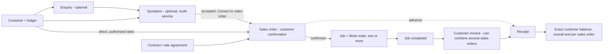
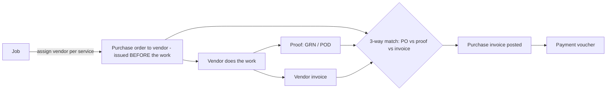

# AENIX ERP — Order-to-Cash, Procure-to-Pay and Warehouse Flow (FLOW-002, extended by FLOW-003)

Version 0.2 | 2026-11-27 | Owner decision: **use the industry-standard flow**, plus (a) one customer invoice can cover several sales orders and (b) receipts can be taken against sales orders, with the customer's exact balance always known. Supersedes FLOW-001 (2026-11-23).

Status: **PROPOSED, prototype only**. Sales orders, vendor purchase orders, multi-SO invoicing, SO advances and the GRN/POD controls extend the signed baseline. DOBIS must record them as a change request before backend contracts are written. Finance rules (accounts, postings, VAT) remain **pending accountant sign-off**.

## 1. Masters

| Master                  | Rule                                                                                                                                                                                      |
| ----------------------- | ----------------------------------------------------------------------------------------------------------------------------------------------------------------------------------------- |
| Customer                | Creating a customer **automatically creates its ledger account** (a sub-ledger under _1200 Accounts receivable_).                                                                         |
| Vendor                  | Creating a vendor automatically creates its ledger account (a sub-ledger under _2100 Accounts payable_).                                                                                  |
| Services / charge codes | Each service has a type: **Transport** (Road/Sea/Air), **Warehouse** or **Direct service** (customs, labour, packing…). Each maps to an income and a cost account.                        |
| Rate cards              | Selling rates (customer or contract) and buying rates (vendor).                                                                                                                           |
| Chart of accounts       | Groups: Assets, Liabilities, Equity, Income, Expenses. Accounts staff **create other ledger accounts** (bank, cash, rent, salaries…). Party sub-ledgers are system-created and read-only. |

## 2. Order to cash (customer)

- **One quotation, sales order or job can mix services:** transport, warehouse and other services together. Transport mode applies only to transport lines.
- **Work Order = Job** (signed rule kept): jobs are created from a **confirmed sales order**.
- **Customer invoice:** select one or more sales orders of the same customer that still have value not invoiced. Each invoice line keeps its sales order, so billing and balance are traceable per order.
- **Receipts** are allocated to invoices, or held as an **advance against a sales order** and later applied to its invoice.
- **Customer balance** = invoiced − received on invoices − advances − unallocated receipts (PDCs shown separately until cleared). It is shown per sales order too: order value, invoiced, not yet invoiced, received, advance, balance.

## 3. Procure to pay (vendor)

- A **PO is issued when a vendor is assigned** on the job (agreed cost). The PO is completed when the work is done.
- The **vendor invoice is recorded against the PO**. A mismatch (amount differs, proof missing, GRN/POD variance) is flagged and needs a reason.
- **Payment vouchers** pay one or more purchase invoices of a vendor (bank, cheque, PDC issued, cash).

## 4. Warehouse (3PL)

| Step           | Who                                 | Document                                 | Check                                               |
| -------------- | ----------------------------------- | ---------------------------------------- | --------------------------------------------------- |
| Inbound advice | Customer (customer portal) or staff | **Packing list (PL) / ASN**              | —                                                   |
| Goods received | Warehouse vendor / team             | **GRN** (uploaded)                       | **PL vs GRN**: short, excess, not received, damaged |
| Release        | Customer or staff                   | **Out-bond / release request**           | Cannot exceed good stock received                   |
| Delivery       | Vendor (vendor portal) or staff     | **POD** (uploaded)                       | **Request vs POD**                                  |
| Monthly        | System                              | Storage billing (pallet-days) + handling | —                                                   |

A GRN is **verified** only when it matches. A request is **closed** only when its POD matches. Otherwise a **variance is raised** for follow-up (claim or credit note; approver to be defined).

## 4a. Warehouse documents (from the owner's real documents, 2026-11-27)

| Document                                                      | Source           | What the system keeps / produces                                                                                                                                                                                                                                                     |
| ------------------------------------------------------------- | ---------------- | ------------------------------------------------------------------------------------------------------------------------------------------------------------------------------------------------------------------------------------------------------------------------------------ |
| **Vendor GRN** — e.g. RHS Logistics "Received Goods Report"   | Warehouse vendor | Header: ASN #, BOE, container no./key, seal, BL, supplier, receiving times. Lines: SKU, description, **Qty Exp / Qty Rec / Dam Qty**, item cube & **CBM**, **production / expiry date, batch**. Imported from Excel with column mapping (RHS headers auto-map), compared with the PL |
| **Customer GRN** — Aenix "Goods Receipt Note" (AEN061 layout) | Aenix → customer | Issued from an uploaded vendor GRN: To customer, inbound date, location; **Batch No, Barcode, Description, Qty Box, Volume (CBM)**, total boxes / total CBM; numbered GRN###                                                                                                         |
| Inbounds and releases repeat                                  | —                | A warehouse job holds **many inbounds** (each PL → GRN) and **many releases** (each request → POD); running stock per SKU = received good − delivered; a release cannot exceed available stock                                                                                       |

## 4b. Tax invoice format (owner's AEN078)

- Numbering **AEN###** (prefix configurable in Settings → Company).
- Company block: logo + tagline, legal name, office address, phone, email, **TRN**.
- Customer block: name, **Attn, mobile, email, P.O. Box address, TRN**; invoice no., invoice date, due date.
- Lines: **Description · Cur · UOM · Quantity · Unit price · Sub total · VAT · Total incl. VAT**; footer "Total Amount Payable AED".
- **Bank details** block (from Settings; not stored in the code repository); "system-generated, no signature" footer.
- Storage is charged by **sq.ft per period** (e.g. "Dry Storage (1-Oct-26 to 30-Oct-26)", 2,600 sq.ft × 5.50), **pallet-day** or **CBM-day**; handling (e.g. 3-ton forklift) **per hour**.

## 5. Accounts

| Document                          | Posting (illustrative, pending accountant sign-off)                                                             |
| --------------------------------- | --------------------------------------------------------------------------------------------------------------- |
| Customer invoice (posted)         | Dr customer sub-ledger (AR) · Cr revenue (4100/4200/4300) · Cr 2200 VAT output                                  |
| Receipt against invoice           | Dr bank / PDC · Cr customer AR                                                                                  |
| Receipt as SO advance             | Dr bank · Cr 2300 Customer advances; applied later: Dr 2300 · Cr AR                                             |
| Vendor invoice (posted)           | Dr 5100 job cost + 1300 VAT input · Cr vendor sub-ledger (AP)                                                   |
| Payment voucher                   | Dr vendor AP · Cr bank (or PDC issued)                                                                          |
| Journals / credit and debit notes | Corrections; posted documents are never edited, only reversed                                                   |
| Controls                          | Trial balance, AR/AP ageing, PDC register, bank reconciliation, VAT return, job profit (job revenue − job cost) |

## 6. Open points for owner / DOBIS / accountant

1. Variance approval: who approves a GRN or POD shortage, and does it create a customer claim, a vendor debit note, or both?
2. Is the warehouse always a vendor, or sometimes the company's own team? (The prototype allows both.)
3. Can a sales order be invoiced in part, per job or milestone? (The prototype allows line-level partial invoicing.)
4. Chart of accounts and posting rules need the accountant's sign-off before Phase 7/8.

## 7. FLOW-003 — industry-standard gap closure (2026-11-28)

Owner request (2026-11-28): apply every gap from the gap analysis in the frontend first; the backend follows after frontend confirmation. Prototype only, on sample data. Optional modules (own fleet, own warehouse floor, multi-currency) are switched in **Settings → Company & system**; they are on in the prototype so they can be reviewed.

| Area          | Gaps closed                                                                                                                                                                                                                                                                                                                              | Where to see it                                                                                                               |
| ------------- | ---------------------------------------------------------------------------------------------------------------------------------------------------------------------------------------------------------------------------------------------------------------------------------------------------------------------------------------- | ----------------------------------------------------------------------------------------------------------------------------- |
| Sales         | C1 follow-up dates; C2 quotation approval by discount/margin; C3 cost and margin (internal); C4 PO ref + confirmation file on confirm; C5 credit block + override; C6 contract surcharge and storage terms; C8 order amendments with versions; C9 cancellation reason and fee; C10 currencies                                            | Enquiries board, quotations, sales orders, contracts, customer page                                                           |
| Warehouse     | W1 arrival planning; W3 variances and claims; W4 bin locations and put-away; W5 lot stock with expiry alerts; W6/W7 FEFO pick list and delivery note; W8 cycle counts with approval; W12 returns into quarantine; W13 minimum charge and free days; W14 handling charges from GRN/POD; W15 portal stock statement                        | Stock and inbounds, Locations, Cycle counts, Variances and claims, job page, storage billing, customer portal                 |
| Transport     | T2 vendor milestone updates and editable times; T3 document checklist per mode; T4 stops with per-stop POD; T5 POD receiver contact and exceptions; T6 vehicles and drivers with expiry alerts; T7 trips with fuel/Salik/allowance costs posted to the job; T8 surcharges needing customer approval; T10 on-time report                  | Job page, Fleet and trips, vendor portal, reports                                                                             |
| Services      | S3 service completion notes as proof; S4 internal costs and job profit; S5 disbursements at cost; S6 minimum charges                                                                                                                                                                                                                     | Job page, services, invoices                                                                                                  |
| Accounts      | A2 stored credit notes; A5 PDC register (deposit, clear, bounce); A6 follow-up and reminders; A7 accruals with auto-reversal; A9 disbursements outside revenue; A10 debit notes; A11 payment approval; A12 VAT return draft; A13 bank reconciliation; A14 period lock; A15 job profitability; A16 write-off; A18 expenses and petty cash | Invoices, Receipts and PDC, Payments, Expenses, Accounting (accruals, bank reconciliation, VAT return, period close), reports |
| Cross-cutting | X1 roles matrix (proposed); X2 approval matrix and inbox; X3 audit log; X4 yearly numbering; X5 printable PO, voucher, statement, delivery note; X6 portal additions; X7 notification channels; X8 new reports                                                                                                                           | Approvals, Settings, Audit log, portals, reports                                                                              |

Every new finance screen is marked **pending accountant sign-off**; roles are **proposed** until SEC-001. The backend contracts are listed as API-DEP-31…44 in `docs/API-DEPENDENCIES.md`; the backend handoff (HO-FLOW-003) is written after the owner confirms the frontend.

### Owner decisions (2026-11-28)

| Decision                 | Outcome in the system                                                                                                                                                                                        |
| ------------------------ | ------------------------------------------------------------------------------------------------------------------------------------------------------------------------------------------------------------ |
| Own trucks — possible    | **Own fleet** stays as an optional module (vehicles, drivers, trips); switch in Settings. Vendor transport keeps working.                                                                                    |
| Own warehouse — possible | **Own warehouse floor** stays as an optional module (bins, put-away, picking, counts); switch in Settings. Vendor warehouses keep working.                                                                   |
| Currency                 | **AED and foreign currencies** (multi-currency on); ledger in AED.                                                                                                                                           |
| Payroll                  | **Outside AENIX** — WPS-compliant payroll provider; one salary journal / expense per month in AENIX (6200 Salaries).                                                                                         |
| Fixed assets             | **Register in AENIX** (`/fixed-assets`): cost, straight-line monthly depreciation, book value, disposal with gain/loss; vehicles link to the fleet. Accountant to confirm method, lives and residual values. |
| Approval limits          | Prototype defaults accepted (Settings → Approvals); can be changed there.                                                                                                                                    |
