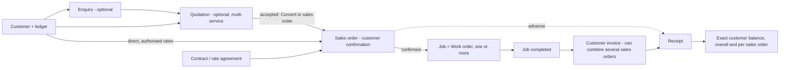
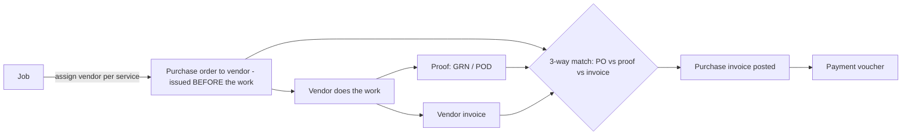

# AENIX ERP — Order-to-Cash, Procure-to-Pay and Warehouse Flow (FLOW-002)

Version 0.2 | 2026-11-27 | Owner decision: **use the industry-standard flow**, plus (a) one customer invoice can cover several sales orders and (b) receipts can be taken against sales orders, with the customer's exact balance always known. Supersedes FLOW-001 (2026-11-23).

Status: **PROPOSED, prototype only**. Sales orders, vendor purchase orders, multi-SO invoicing, SO advances and the GRN/POD controls extend the signed baseline. DOBIS must record them as a change request before backend contracts are written. Finance rules (accounts, postings, VAT) remain **pending accountant sign-off**.

## 1. Masters

| Master                  | Rule                                                                                                                                                                                      |
| ----------------------- | ----------------------------------------------------------------------------------------------------------------------------------------------------------------------------------------- |
| Customer                | Creating a customer **automatically creates its ledger account** (a sub-ledger under _1200 Accounts receivable_).                                                                         |
| Vendor                  | Creating a vendor automatically creates its ledger account (a sub-ledger under _2100 Accounts payable_).                                                                                  |
| Services / charge codes | Each service has a type: **Transport** (Road/Sea/Air), **Warehouse** or **Direct service** (customs, labour, packing…). Each maps to an income and a cost account.                        |
| Rate cards              | Selling rates (customer or contract) and buying rates (vendor).                                                                                                                           |
| Chart of accounts       | Groups: Assets, Liabilities, Equity, Income, Expenses. Accounts staff **create other ledger accounts** (bank, cash, rent, salaries…). Party sub-ledgers are system-created and read-only. |

## 2. Order to cash (customer)

- **One quotation, sales order or job can mix services:** transport, warehouse and other services together. Transport mode applies only to transport lines.
- **Work Order = Job** (signed rule kept): jobs are created from a **confirmed sales order**.
- **Customer invoice:** select one or more sales orders of the same customer that still have value not invoiced. Each invoice line keeps its sales order, so billing and balance are traceable per order.
- **Receipts** are allocated to invoices, or held as an **advance against a sales order** and later applied to its invoice.
- **Customer balance** = invoiced − received on invoices − advances − unallocated receipts (PDCs shown separately until cleared). It is shown per sales order too: order value, invoiced, not yet invoiced, received, advance, balance.

## 3. Procure to pay (vendor)

- A **PO is issued when a vendor is assigned** on the job (agreed cost). The PO is completed when the work is done.
- The **vendor invoice is recorded against the PO**. A mismatch (amount differs, proof missing, GRN/POD variance) is flagged and needs a reason.
- **Payment vouchers** pay one or more purchase invoices of a vendor (bank, cheque, PDC issued, cash).

## 4. Warehouse (3PL)

| Step           | Who                                 | Document                                 | Check                                               |
| -------------- | ----------------------------------- | ---------------------------------------- | --------------------------------------------------- |
| Inbound advice | Customer (customer portal) or staff | **Packing list (PL) / ASN**              | —                                                   |
| Goods received | Warehouse vendor / team             | **GRN** (uploaded)                       | **PL vs GRN**: short, excess, not received, damaged |
| Release        | Customer or staff                   | **Out-bond / release request**           | Cannot exceed good stock received                   |
| Delivery       | Vendor (vendor portal) or staff     | **POD** (uploaded)                       | **Request vs POD**                                  |
| Monthly        | System                              | Storage billing (pallet-days) + handling | —                                                   |

A GRN is **verified** only when it matches. A request is **closed** only when its POD matches. Otherwise a **variance is raised** for follow-up (claim or credit note; approver to be defined).

## 5. Accounts

| Document                          | Posting (illustrative, pending accountant sign-off)                                                             |
| --------------------------------- | --------------------------------------------------------------------------------------------------------------- |
| Customer invoice (posted)         | Dr customer sub-ledger (AR) · Cr revenue (4100/4200/4300) · Cr 2200 VAT output                                  |
| Receipt against invoice           | Dr bank / PDC · Cr customer AR                                                                                  |
| Receipt as SO advance             | Dr bank · Cr 2300 Customer advances; applied later: Dr 2300 · Cr AR                                             |
| Vendor invoice (posted)           | Dr 5100 job cost + 1300 VAT input · Cr vendor sub-ledger (AP)                                                   |
| Payment voucher                   | Dr vendor AP · Cr bank (or PDC issued)                                                                          |
| Journals / credit and debit notes | Corrections; posted documents are never edited, only reversed                                                   |
| Controls                          | Trial balance, AR/AP ageing, PDC register, bank reconciliation, VAT return, job profit (job revenue − job cost) |

## 6. Open points for owner / DOBIS / accountant

1. Variance approval: who approves a GRN or POD shortage, and does it create a customer claim, a vendor debit note, or both?
2. Is the warehouse always a vendor, or sometimes the company's own team? (The prototype allows both.)
3. Can a sales order be invoiced in part, per job or milestone? (The prototype allows line-level partial invoicing.)
4. Chart of accounts and posting rules need the accountant's sign-off before Phase 7/8.
